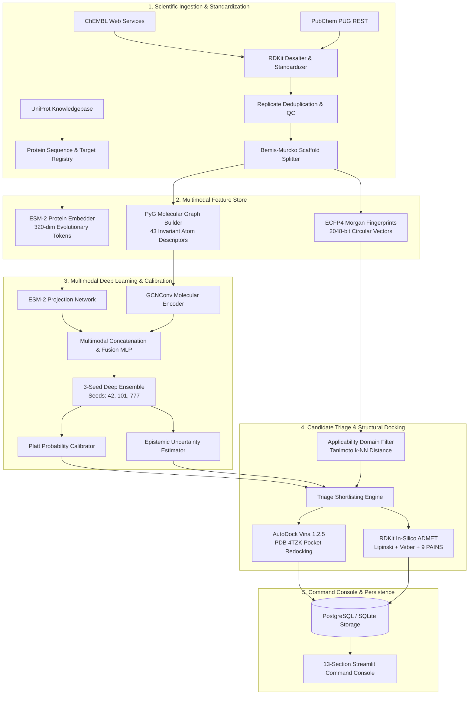
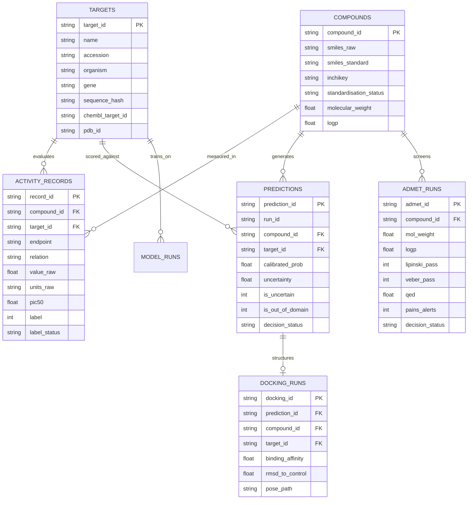

# Antimicrobial-Resistance (AMR) Drug Target Discovery
### Molecular GNNs and Protein Language Models under Scaffold-Aware Validation

[](https://python.org)
[](https://pytorch-geometric.readthedocs.io/)
[](https://www.rdkit.org/)
[](https://github.com/Mahirlokare/amr-drug-target-discovery/actions)
[](https://amr-drug-target-discovery.onrender.com)
[](LICENSE)

> 🚀 **Live Cloud Application**: [https://amr-drug-target-discovery.onrender.com](https://amr-drug-target-discovery.onrender.com)  
> 🏥 **Healthcheck Endpoint**: [https://amr-drug-target-discovery.onrender.com/_stcore/health](https://amr-drug-target-discovery.onrender.com/_stcore/health)

An end-to-end reproducible computational research platform designed to prioritize small-molecule therapeutics against high-impact bacterial targets relevant to antimicrobial resistance (AMR), specifically focusing on **_Mycobacterium tuberculosis_ Enoyl-[acyl-carrier-protein] reductase [NADH] (InhA)**.

---

## 🎯 Primary Research Question
> *Can a molecular Graph Neural Network combined with ESM-2 protein-language-model embeddings prioritise potentially active small molecules against bacterial AMR targets more reliably than standard baselines under leakage-resistant, scaffold-aware evaluation?*

---

## 🧬 Scientific Focus & Target Profile
- **Pathogen**: *Mycobacterium tuberculosis* (strain ATCC 25618 / H37Rv)
- **Target Protein**: InhA (Enoyl-ACP reductase [NADH], locus tag `Rv1484`)
- **UniProt Accession**: [`P9WGR1`](https://www.uniprot.org/uniprotkb/P9WGR1)
- **ChEMBL Target**: [`CHEMBL2014`](https://www.ebi.ac.uk/chembl/target_report_card/CHEMBL2014/)
- **Primary PDB Structure**: [`4TZK`](https://www.rcsb.org/structure/4TZK) (Chain A, with cofactor NAD+)
- **Biological Role**: Essential enzyme in the Type II fatty acid synthesis (FAS-II) pathway responsible for mycolic acid envelope assembly. Clinically validated target of isoniazid (INH) and direct InhA inhibitors (such as triclosan analogues, GEQ, NITD-916, and pyridomycin). Target of key mutations conferring clinical drug resistance.

---

## 🔬 Core Innovations & Methodological Rigor

1. **Strict Data Hygiene & Label Policy**:
   - Single standardized endpoint: direct biochemical **IC50 (nM)**.
   - Active: `IC50 <= 1000 nM` (`pIC50 >= 6.0`).
   - Inactive: `IC50 > 10000 nM` (`pIC50 < 5.0`).
   - Intermediate / Ambiguous: `1000 nM < IC50 <= 10000 nM` are quarantined, not silently labeled as negative!
   - Replicate aggregation via geometric mean; conflicting measurements (>1.0 log span) are quarantined.

2. **Zero-Leakage Bemis-Murcko Scaffold Partitioning**:
   - Automated assertions verify zero scaffold overlap between Train, Validation, and Test partitions:
     ```python
     assert train_scaffolds.isdisjoint(test_scaffolds)
     assert train_compounds.isdisjoint(test_compounds)
     ```

3. **Multimodal Deep Learning Architecture**:
   - **Molecular Graph**: PyG GCN with 43-dimensional invariant atom node features.
   - **Protein Embedding**: ESM-2 (`esm2_t6_8M_UR50D`) 320-dimensional mean-pooled representation.
   - **Interaction Fusion**: Multimodal concatenation + LayerNorm + MLP interaction head.

4. **Honest Uncertainty & Calibration**:
   - 3-seed Deep Ensemble (`seeds=[42, 101, 777]`) and Monte Carlo Dropout to quantify epistemic uncertainty.
   - Platt probability calibration fitted strictly on validation logits.
   - Applicability domain warning based on nearest-neighbor Tanimoto similarity to training chemical space.

5. **Multi-Stream Computational Triage**:
   - **AutoDock Vina Docking**: Standardized grid search box on InhA substrate pocket near Tyr158 with redocking control (RMSD < 2.0 Å).
   - **In-Silico ADMET**: Lipinski Rule of 5, Veber oral bioavailability, QED, Synthetic Accessibility, and 9 PAINS substructure alert checks.

6. **Retrospective Active Learning Simulation**:
   - Compares Uniform Random, Greedy Activity, Uncertainty Sampling, and Balanced Multi-Objective (Activity + Uncertainty + MaxMin Tanimoto Diversity) policies over sequential screening rounds.

---

## 🏛️ System Architecture & Data Flow

### 1. High-Level Research System Architecture


### 2. Relational Database Entity-Relationship Architecture


---

## 🚀 Quickstart & Reproduction

### 1. Installation
```powershell
git clone https://github.com/Mahirlokare/amr-drug-target-discovery.git
cd amr-drug-target-discovery
pip install -r requirements.txt
```

### 2. Execute Complete Pipeline
Run data ingestion, quality audits, scaffold splitting, baseline comparisons, GNN + ESM-2 training, active learning simulation, and docking triage:
```powershell
python run_pipeline.py
```

### 3. Launch Interactive Command Console
```powershell
streamlit run src/app/streamlit_app.py
```

### 4. Run Automated Test Suite (48/48 Passing)
```powershell
pytest tests/ -v
```

---

## 📁 Repository Structure

```
amr-drug-discovery/
├── README.md                          # Comprehensive documentation & architecture diagrams
├── pyproject.toml                     # Python project packaging metadata
├── requirements.txt                   # Production dependencies (torch, PyG, RDKit, psycopg2)
├── run_pipeline.py                    # End-to-end automated research workflow orchestrator
├── render.yaml                        # Render Blueprint IaC configuration
├── render-build.sh                    # Automated Render build script
├── configs/                           # Central YAML scientific configuration files
│   ├── data_sources.yaml              # ChEMBL, PubChem, UniProt endpoints & rate limits
│   ├── target_registry.yaml           # WHO AMR priority targets (InhA, DprE1, GyrA, PBP3, NDM-1)
│   ├── labels.yaml                    # Multi-endpoint policies (IC50, Ki, Kd, EC50, MIC)
│   ├── features.yaml                  # Graph featurization & ESM-2 embedding settings
│   ├── model_gnn.yaml                 # PyG GCN + ESM-2 fusion model hyperparameters
│   ├── evaluation.yaml                # Bemis-Murcko scaffold split & metrics config
│   └── docking.yaml                   # AutoDock Vina grid box coordinates & receptor configs
├── data/                              # Data directories with versioned benchmarks
│   ├── processed/inha_benchmark_v1.json
│   └── amr_discovery.db               # Persistent SQLite / PostgreSQL storage
├── artifacts/                         # Model weights, embeddings, poses, and reports
│   ├── checkpoints/                   # PyTorch ensemble checkpoints (seeds: 42, 101, 777)
│   ├── checkpoints/                   # Versioned checkpoints & model_release_v1.json
│   ├── embeddings/                    # Cached ESM-2 320-dim protein representations
│   ├── docking/                       # Cleaned PDB/PDBQT structures & docked poses
│   └── reports/                       # Generated audit reports and evaluation JSONs
├── src/                               # Modular scientific source code
│   ├── common/                        # Config, logging, provenance, knowledge engine
│   ├── ingestion/                     # ChEMBL, PubChem, UniProt, RCSB PDB REST clients
│   ├── data/                          # Schemas, resolver, standardizer, deduplicator, splits
│   ├── features/                      # PyG graphs, ECFP4 fingerprints, ESM-2 embedder
│   ├── models/                        # GCN encoder, fusion model, predict, train, calibration
│   ├── active_learning/               # Acquisition policies & sequential screening simulator
│   ├── explainability/                # Input x Gradient atom saliency & substructure maps
│   ├── docking/                       # AutoDock Vina execution, receptor & ligand prep
│   ├── admet/                         # Lipinski Ro5, Veber, QED, Synthetic Accessibility, PAINS
│   ├── evaluation/                    # AUROC, PR-AUC, EF@1%, Brier score, ECE metrics
│   ├── storage/                       # Dual PostgreSQL / SQLite database manager
│   └── app/                           # 10-Page Research Command Architecture
│       ├── streamlit_app.py           # Research Dashboard (Overview & Executive Command Console)
│       └── pages/
│           ├── 01_Target_Explorer.py  # Target Explorer: UniProt annotations & 3D WebGL viewer
│           ├── 02_Data_Explorer.py    # Data Explorer: ChEMBL bioactivity curation & QC
│           ├── 03_Molecular_Analysis.py # Molecular Analysis: Universal resolver & PyG graph inspector
│           ├── 04_Protein_Analysis.py # Protein Analysis: Sequence input & ESM-2 embeddings
│           ├── 05_Model_Laboratory.py # Model Laboratory: GNN + ESM-2 fusion & active learning
│           ├── 06_Model_Evaluation.py # Model Evaluation: Zero-leakage splits & calibration curves
│           ├── 07_Candidate_Discovery.py # Candidate Discovery: High-throughput screening & triage
│           ├── 08_Docking_and_ADMET.py # Docking & ADMET: AutoDock Vina & safety screening
│           └── 09_Reports.py          # Reports: Model Cards, Dataset Cards & prediction audit logs
├── tests/                             # Comprehensive 11-category automated test suite (51 tests)
│   ├── conftest.py                    # Pytest environment & path configuration
│   ├── unit/                          # Unit tests for RDKit, graphs, calibration, DB CRUD
│   ├── integration/                   # Data build -> split -> feature extraction chain
│   ├── leakage/                       # Bemis-Murcko zero-leakage mathematical assertions
│   ├── regression/                    # Baseline performance benchmarks & stability
│   ├── models/                        # GNN encoder, fusion forward pass, deterministic loading
│   ├── embeddings/                    # ESM-2 hashing, dimension validation, surrogate tagging
│   ├── scientific/                    # Multi-endpoint bioactivity curation (IC50, Ki, Kd, EC50, MIC)
│   ├── docking/                       # Vina execution, surrogate fallback & record parsing
│   ├── app/                           # 10-page syntax & navigation verification
│   └── e2e/                           # End-to-end triage: SMILES -> GNN -> Docking -> ADMET -> DB
└── docs/                              # Scientific documentation & governance cards
    ├── dataset_card.md                # Data provenance, curation policy, assay sources
    ├── model_card.md                  # GNN + ESM-2 architecture, training details, limits
    ├── validation_protocol.md         # Scaffold partitioning & evaluation protocol
    └── architecture/                  # System architecture specifications

---

## ⚖️ Scientific Governance & Responsible Research
**Guiding Principle**: Build a scientifically careful system that can explain what it knows, what it does not know, and why a candidate was prioritised.
- Predicted affinities, in-silico ADMET scores, and model classifications are computational evidence and **do not constitute proof of antimicrobial efficacy, bacterial clearance, or safety**.
- In accordance with biological safety protocols, this software provides no pathogen-handling or wet-lab experimental synthesis protocols.
